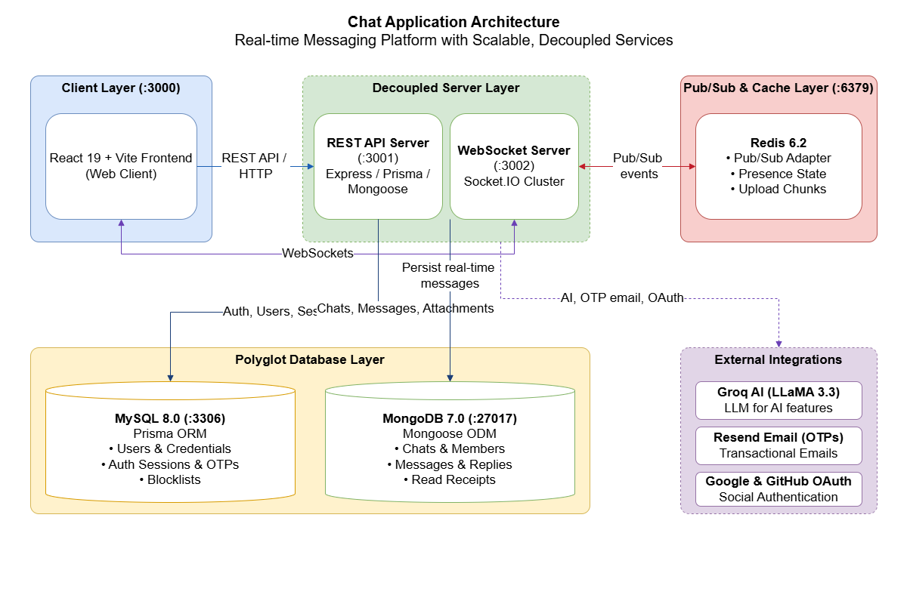
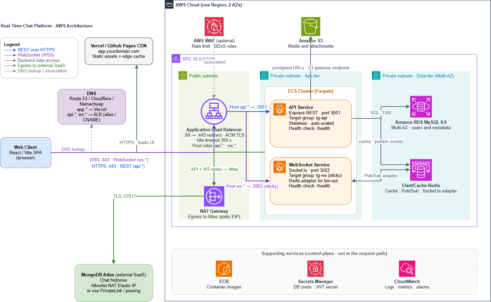

<div align="center">
  
  <h1>Quorent</h1>
  <p><strong>Scalable Full-Stack Real-Time Messaging Application</strong></p>

  <p>
    
    
    
    
    
    
    
    
    
    
  </p>
</div>

---

Quorent is a high-performance, real-time messaging platform built for scale. It features a **hybrid polyglot persistence architecture** (MySQL for relational identity, auth, and sessions; MongoDB for high-throughput chats, messages, and read receipts), decouples the REST API from dedicated WebSocket instances scaled via Redis pub/sub, and integrates AI assistance, web push notifications, and OAuth.

---

## ✨ Key Features

- **Real-Time Messaging**: Instant delivery, live typing indicators, delivery & read receipts, and presence via Socket.IO.
- **Message Replies & Context**: Interactive reply chaining with embedded snapshots and click-to-scroll navigation.
- **Polyglot Persistence**: **MySQL (Prisma)** for strict ACID user identity & auth; **MongoDB (Mongoose)** for high-throughput chats & messages.
- **Decoupled WebSocket Architecture**: Standalone WebSocket server (`:3002`) isolated from the REST API (`:3001`), horizontally scaled via Redis.
- **AI-Powered Assistance**: Smart replies, chat summarization, and message translation powered by Groq (LLaMA 3.3).
- **Chunked File Transfers & S3 Storage**: Large file transfers sliced into Redis buffer caches, assembled asynchronously, and backed by Amazon S3.
- **Direct & Group Chats**: 1-on-1 private messaging and multi-member group chats with admin moderation.
- **Robust Authentication**: JWT access & refresh token rotation, email OTP verification, and OAuth 2.0 (Google & GitHub).

---

## 🏗️ Architecture Overview

Quorent is designed with high scalability and separation of concerns at its core. Below are the core **System Architecture** and the production **AWS Cloud Deployment Architecture**.

### 1. System Architecture

A decoupled, multi-tier layout where the client connects independently to stateless REST API endpoints and stateful WebSocket instances bridged by Redis.

<p align="center">
  
</p>

- **Client Layer (`:3000`)**: Responsive React 19 SPA powered by Vite, handling message streaming, typing feedback, and client-side caching.
- **Decoupled Server Layer**:
  - **REST API Server (`:3001`)**: Express backend providing endpoints for authentication, user profiles, social OAuth callbacks, AI requests, and file metadata.
  - **WebSocket Server (`:3002`)**: Dedicated Socket.IO cluster handling persistent WebSocket connections, room multiplexing, presence indicators, and message events. Persists real-time messages directly to MongoDB.
- **Pub/Sub & Cache Layer (`:6379`)**: Redis 6.2 acting as the multi-instance Socket.IO pub/sub adapter, holding active user presence states and chunked upload buffers.
- **Polyglot Database Layer**:
  - **MySQL 8.0 (`:3306`) with Prisma ORM**: Enforces relational integrity and ACID guarantees for users, credentials, refresh sessions, email OTPs, and blocklists.
  - **MongoDB 7.0 (`:27017`) with Mongoose ODM**: Schema-flexible document store for conversation channels, high-volume message histories, replies, and read receipts.
- **External Integrations**:
  - **Groq AI (LLaMA 3.3 70B)**: Real-time message translation, smart replies, and conversation summarization.
  - **Resend**: Transactional email verification and OTP delivery.
  - **Google & GitHub OAuth 2.0**: Third-party federated identity authentication.

#### Service Breakdown

| Service              | Port    | Technology                | Purpose                                    |
| :------------------- | :------ | :------------------------ | :----------------------------------------- |
| **Frontend Client**  | `3000`  | React 19, Vite            | Responsive web application UI              |
| **REST API Server**  | `3001`  | Express, Prisma, Mongoose | Auth, users, chats, messages, AI, uploads  |
| **WebSocket Server** | `3002`  | Socket.IO, Redis Adapter  | Real-time messaging, presence, receipts    |
| **Redis**            | `6379`  | Redis 6.2                 | Pub/Sub broker, presence, & message cache  |
| **MySQL Database**   | `3306`  | MySQL 8.0 (Prisma)        | Users, credentials, sessions, OTPs, blocks |
| **MongoDB Database** | `27017` | MongoDB 7.0 (Mongoose)    | Chats, messages, attachments, receipts     |

---

### 2. AWS Cloud Deployment Architecture

Enterprise-ready cloud infrastructure spanning multiple Availability Zones within a secure Amazon Virtual Private Cloud (VPC).

<p align="center">
  
</p>

- **Edge & DNS Layer**:
  - **DNS (Route 53 / Cloudflare)**: Directs client traffic (`app.*` / apex) to the frontend hosting CDN and backend requests (`api.*`, `ws.*`) to the Application Load Balancer.
  - **Frontend Delivery (Vercel / GitHub Pages CDN)**: Fast, globally distributed edge CDN serving the compiled React/Vite single-page application (`quorent.xyz`).
  - **AWS WAF (Web Application Firewall)**: Protects public entry points against DDoS attacks and applies rate-limiting rules.
- **Public Subnets**:
  - **Application Load Balancer (ALB)**: SSL/TLS termination via AWS Certificate Manager (ACM) with automatic HTTP (`:80`) to HTTPS (`:443`) redirection and 300s idle timeout.
    - **Host Routing (`api.*`)**: Routes REST HTTP requests to the stateless `tg-api` target group on port `3001`.
    - **Host Routing (`ws.*`)**: Routes WebSocket (WSS) traffic with sticky sessions to the `tg-ws` target group on port `3002`.
  - **NAT Gateway**: Provides a dedicated static Elastic IP (EIP) for private subnet egress to MongoDB Atlas and external APIs.
- **Private Subnets — Application Tier (AWS ECS Fargate)**:
  - **API Service Tasks**: Containerized Express REST services horizontally auto-scaled based on traffic, monitored via `/health`.
  - **WebSocket Service Tasks**: Containerized Socket.IO instances with sticky affinity and inter-task sync over Redis, monitored via `/health`.
- **Private Subnets — Data Tier (Multi-AZ)**:
  - **Amazon RDS MySQL 8.0**: Multi-AZ managed relational database for fault tolerance and zero-downtime failover.
  - **Amazon ElastiCache for Redis**: In-memory cluster for high-speed caching and Socket.IO Pub/Sub synchronization.
- **Object Storage & SaaS Services**:
  - **Amazon S3**: Scalable storage for images, videos, and attachments, accessed securely via presigned upload/download URLs and an S3 VPC Gateway Endpoint.
  - **MongoDB Atlas**: Managed document database with network allowlisting restricted to the AWS NAT Gateway Elastic IP (or AWS PrivateLink / VPC Peering).
- **Supporting AWS Management Services**:
  - **AWS ECR**: Docker container registry for automated CI/CD task deployment.
  - **AWS Secrets Manager**: Secure secret injection for DB credentials, JWT secrets, and external API keys.
  - **Amazon CloudWatch**: Centralized logging, application metrics, and health alarms.

---

## 🚀 Quick Start

### Option 1: Docker Compose

```bash
# 1. Clone repository and setup environment
git clone https://github.com/rushikbuikds/Quorent-Chat-Messaging-App.git
cd Quorent-Chat-Messaging-App
cp server/.env.example server/.env
cp client/.env.example client/.env

# 2. Spin up all services
docker compose up -d
```

Access the client at **http://localhost:3000**.

### Option 2: Local Development

**Prerequisites**: Node.js 18+, MySQL 8.0, MongoDB 7.0+, and Redis 6.2+.

```bash
# 1. Install dependencies
cd server && npm install
cd ../client && npm install
cd ..

# 2. Configure environment
cp server/.env.example server/.env
cp client/.env.example client/.env

# 3. Synchronize database schemas
cd server
npm run db:generate
npm run db:push

# 4. Start backend (runs REST API on :3001 and WS on :3002 concurrently)
npm run dev

# 5. Start frontend (in a separate terminal)
cd ../client
npm start
```

---

## ⚙️ Key Scripts

| Command               | Working Directory | Description                                      |
| :-------------------- | :---------------- | :----------------------------------------------- |
| `npm run dev`         | `/server`         | Runs API (`:3001`) and WS (`:3002`) concurrently |
| `npm run dev:api`     | `/server`         | Runs REST API server only                        |
| `npm run dev:ws`      | `/server`         | Runs WebSocket server only                       |
| `npm run db:generate` | `/server`         | Generates Prisma Client types                    |
| `npm run db:push`     | `/server`         | Synchronizes MySQL schema with Prisma            |
| `npm start`           | `/client`         | Starts Vite development server (`:3000`)         |
| `npm run build`       | `/client`         | Builds frontend production bundle                |

---

## 📄 License

This project is licensed under the [ISC License](LICENSE).
